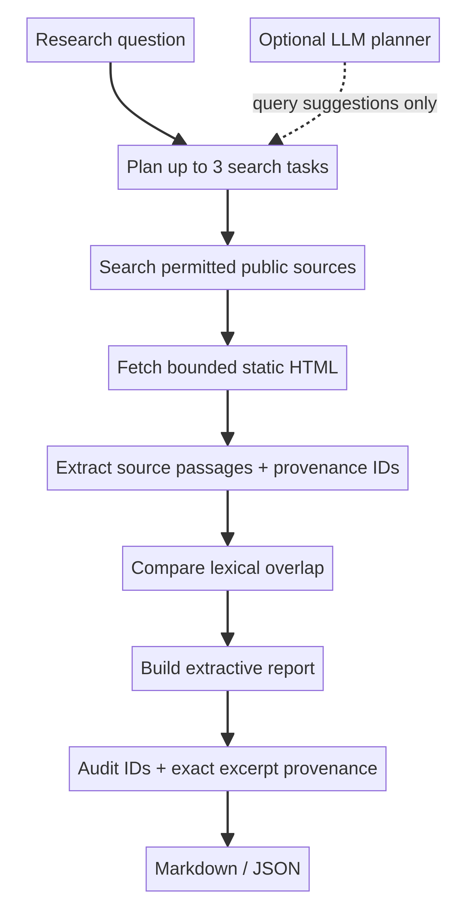

# Personal AI Research Agent

A local-first research assistant that turns a question into bounded search tasks, gathers public web evidence, compares source excerpts, and produces Markdown or JSON research briefs. The workflow uses LangGraph, replaceable search/fetch adapters, and a no-key extractive default.

## Why its citations are safer

The optional language model is used only to suggest search queries. It does **not** write report findings or source labels. After pages are fetched, the application assigns source IDs (`S1`, `S2`, …), copies extracted passages into findings, attaches the matching IDs, and audits that each finding exactly matches an excerpt in every cited evidence record. This prevents model-invented citations and fabricated source IDs from entering the final findings.

The check is intentionally narrow: it verifies provenance and exact excerpt reuse, not whether a source is truthful, authoritative, current, or logically sufficient to support a broader conclusion. The report keeps the excerpt and URL visible for human review. Search-result snippets are explicitly marked when a page cannot be fetched.

## Workflow

1. **Plan:** create up to three distinct searches—direct evidence, primary/official sources, and limitations or contrary evidence. An explicitly enabled model may suggest those searches.
2. **Search:** use DuckDuckGo Lite by default or a user-configured SearXNG JSON endpoint.
3. **Fetch:** retrieve only public HTTP(S) HTML pages, with bounded timeouts and response sizes; reject local/private destinations and re-check redirects.
4. **Analyze:** select relevant source text within a character cap, preserve its provenance, and calculate lexical overlap between pairs of sources.
5. **Report:** emit exact excerpts, source metadata, comparison notes, warnings, and a citation audit as Markdown or JSON.



## Run it

Requires Python 3.10+.

```bash
git clone https://github.com/bereket-web/personal-ai-research-agent.git
cd personal-ai-research-agent
python3 -m venv .venv
source .venv/bin/activate
python -m pip install -r requirements.txt
python -m unittest discover -s tests -v
python -m research_agent "How do stateful agent workflows work?" --max-results 4 --max-pages 4
```

Save a report or its structured data:

```bash
python -m research_agent "Compare evidence for two approaches" --out output/brief.md
python -m research_agent "Compare evidence for two approaches" --json --out output/brief.json
```

The number of queries, results per query, and fetched pages are capped in code. The default report does not require an LLM API key.

## Permitted search sources

For a self-hosted SearXNG instance with JSON search enabled:

```bash
export SEARXNG_URL="http://localhost:8080"
python -m research_agent "A source-backed research question"
```

Otherwise, the built-in DuckDuckGo Lite adapter uses its public HTML endpoint. Its markup is not a stable API and can change, be rate-limited, or return no results. Respect the search provider's terms and the destination sites' access policies. The agent fetches only a small number of pages and does not crawl whole sites.

## Optional model-assisted planning

Model use is opt-in and limited to query planning. Configure an OpenAI-compatible endpoint and pass `--use-model`:

```bash
export OPENAI_API_KEY="your-key"
export OPENAI_BASE_URL="https://api.openai.com/v1"
export OPENAI_MODEL="your-chat-model"
python -m research_agent "A source-backed research question" --use-model
```

`OPENAI_BASE_URL` is preferred; `OPENAI_API_BASE` is also accepted. The model is not given retrieved web pages and cannot write findings or citations. If planning fails, the local plan is used. A key is never stored in project files or reports; see `.env.example` for variable names.

## Output and verification

JSON contains the research plan, findings, pairwise source comparisons, citation audit, evidence records, and run warnings. Each evidence record includes the source ID, title, URL, originating query, retrieval time, excerpt, retrieval method, search provider, and extractor. The local test suite uses fake search/fetch adapters and synthetic content; it verifies workflow mechanics and citation safeguards, not web coverage or research accuracy.

A one-time live CLI check against two Python documentation pages is recorded in [the smoke-test note](evaluation/live-smoke.md); it is not a quality benchmark.

Run the tests with:

```bash
python -m unittest discover -s tests -v
```

## Development checks

GitHub Actions runs the locked test suite, Ruff, and package builds on Python 3.10, 3.12, and 3.13 for pushes and pull requests. To run the same checks locally:

```bash
uv sync --locked --extra test
uv run pytest
uv run ruff check research_agent tests
uv build
```

## Safety and limits

- The page fetcher accepts only HTTP(S) URLs, rejects credentials and non-public IP addresses, limits pages to 1.5 MB and extracted text to 28,000 characters, and follows only redirects that pass the same URL check.
- DNS/IP checks are best-effort and do not eliminate DNS-rebinding or time-of-check/time-of-use risks. Production deployment should also enforce outbound network restrictions.
- Retrieved page text is treated as untrusted evidence. The current system does not execute scripts, follow page instructions, use page text to choose tools, or send retrieved content to the optional model.
- The system does not render JavaScript, parse PDFs, authenticate to sites, score source authority, persist run history, or independently fact-check claims.
- Pairwise term overlap is a simple comparison heuristic, not evidence of factual agreement or disagreement.
- Search snippets and extracted pages can be wrong, incomplete, biased, copyrighted, or outdated. Check primary sources and review excerpts before relying on a conclusion.

See [design decisions](DESIGN_DECISIONS.md) and the [ecosystem notes](ECOSYSTEM_REPORT.md) for additional implementation context.
